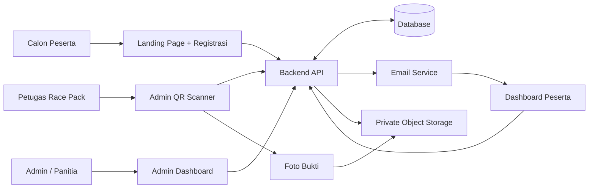

# PRODUCT REQUIREMENTS DOCUMENT (PRD)
## Interactive Website Pitch Deck — KONI Kabupaten Cianjur | Cianjur Berlari Bupati Series Season 2

**Versi:** 1.0 — Proposal / AI Agent Build Specification  
**Jenis produk yang HARUS dibangun:** WEBSITE PITCH DECK INTERAKTIF (bukan website registrasi event production).  
**Bahasa UI:** Bahasa Indonesia.  
**Audiens presentasi:** Pimpinan KONI Kabupaten Cianjur, panitia penyelenggara, pemangku kepentingan, dan calon mitra.  
**Status materi:** Konsep dan usulan, belum merupakan keputusan resmi penyelenggara.  

---

## 1. Pernyataan produk dan batasan wajib

Bangun **website presentasi interaktif** yang digunakan presenter untuk pitching konsep ekosistem website **Cianjur Berlari Bupati Series Season 2**. Presentasi harus terasa seperti pengalaman produk digital premium: bukan PDF, bukan kumpulan screenshot statis, bukan template PowerPoint yang dipindahkan ke browser. Website ini menggabungkan **storytelling presentasi, diagram arsitektur, visualisasi UI konsep, dan demonstrasi interaktif**.

**Penting: bedakan dua level:**
1. **Produk yang dibangun saat ini:** pitch deck website yang berjalan dan dapat dipresentasikan secara lokal/deploy.
2. **Produk yang dipitch:** rencana platform event yang mencakup public landing page, registrasi, dashboard peserta, dashboard admin, QR race pack, dan operasional panitia.

Semua interaksi bisnis dalam pitch deck adalah **demo berbasis mock data**, tanpa database peserta sungguhan, pengiriman email nyata, pembayaran nyata, atau penyimpanan foto sensitif. Jangan membangun platform event production kecuali diminta terpisah.

## 2. Tujuan dan hasil presentasi

### 2.1 Tujuan bisnis
- Meyakinkan pemangku kepentingan bahwa platform digital terintegrasi meningkatkan pengalaman peserta dan ketertiban operasi event.
- Menunjukkan perjalanan peserta dari registrasi hingga pengambilan race pack sebagai satu sistem yang terhubung.
- Membantu audiens memahami efisiensi dashboard admin, validasi QR, dokumentasi foto, dan pencegahan klaim ganda.
- Mempermudah pembahasan scope, prioritas fitur, timeline, risiko, dan keputusan yang dibutuhkan.

### 2.2 Keputusan yang diharapkan
- Persetujuan arah konsep dan user experience.
- Validasi kebutuhan data pendaftaran, aturan kuota/kategori, jalur akses peserta, dan kebijakan race pack.
- Persetujuan tahapan pengerjaan dan tahap lanjutan penawaran implementasi.

### 2.3 Ukuran keberhasilan pitch deck
- Bisa dipresentasikan end-to-end tanpa koneksi backend.
- Navigasi cepat dan stabil di laptop/proyektor, termasuk keyboard.
- Audiens dapat melihat 3 demo: registrasi, dashboard peserta, dan scan-pickup.
- Informasi penting dapat dipahami pada layar 16:9 tanpa perlu membaca paragraf panjang.
- Semua angka contoh ditandai sebagai ilustrasi.

## 3. Target pengguna website pitch deck

**Presenter:** mengendalikan alur cerita, berpindah scene/section, memperbesar mockup, menjalankan demo.  
**Audiens:** melihat strategi, fitur, rancangan visual, data/arsitektur, dan demonstrasi tanpa perlu berinteraksi langsung.  
**Reviewer internal:** membuka website secara mandiri untuk mengevaluasi konsep dan memberi masukan.

## 4. Format pengalaman dan pola navigasi

**Format utama:** Single-page immersive presentation dengan section/scene full viewport, memberi rasa seperti presentasi produk teknologi kelas premium. Desktop-first (1366×768 dan 1920×1080), tetap usable di tablet/mobile.

**Fitur presentasi:**
- Mode **Presentation**: scroll-snap halus per scene; tombol Next/Previous; indikator progres dan nomor scene; hotkeys `ArrowRight`, `ArrowLeft`, `Space` (next), `Escape` (tutup overlay/modal).
- Mode **Explore**: navigasi bebas melalui daftar isi / menu scene; scroll normal; memungkinkan review mandiri.
- Toggle presentation/explore, fullscreen (jika didukung browser), shortcut help, dan `?` untuk daftar pintasan.
- URL anchor untuk deep link ke tiap scene; refresh tetap membuka section yang dipilih.
- Transisi yang elegan (durasi kira-kira 250–500 ms), dukungan `prefers-reduced-motion`.
- Menu navigasi minimalis yang tidak mengganggu konten; indikator progres presentasi.
- CTA kontekstual seperti **Lihat Alur**, **Buka Demo Dashboard**, **Simulasikan Scan QR**, **Lihat Arsitektur**.

**Prinsip presentasi:** satu ide utama per scene, judul kuat, sedikit teks, visual besar, kemampuan drill down untuk detail. Konten teknis mendalam ditampilkan lewat expandable panels, tooltips, appendix, atau modal.

## 5. Struktur narasi / sitemap pitch deck (minimum 18 scene)

Semua scene harus memiliki headline, short description, komposisi visual, dan (bila relevan) elemen interaktif.

| ID | Scene / route anchor | Pesan utama | Artefak visual / interaksi |
|---|---|---|---|
| 01 | `#opening` — Cover | Cianjur Berlari S2: One Integrated Digital Race Experience | Hero sinematik abstrak bernuansa olahraga, judul, subtitle, identitas KONI placeholder |
| 02 | `#vision` — Visi | Dari halaman event menuju ekosistem digital terpadu | Visual transformasi before/after berbasis konsep; tidak mengklaim platform lama buruk |
| 03 | `#challenge` — Tantangan | Registrasi, informasi, dan distribusi race pack perlu terhubung | 3 pain-point cards dengan contoh alur operasional |
| 04 | `#solution` — Solusi 3 Pilar | Public Experience, Participant Experience, Admin Operations | Diagram tiga pilar yang terhubung |
| 05 | `#journey` — Event Journey | Registrasi → email akses → dashboard → race pack | Journey stepper interaktif; klik node untuk highlight |
| 06 | `#architecture` — High-level Architecture | Arsitektur modular, aman, scalable | Diagram public website ↔ API/service ↔ data, mail, QR, storage; overview level konsep |
| 07 | `#landing` — Landing Page | Event identity premium dan konversi registrasi | Mockup browser landing page; area replaceable mockup |
| 08 | `#landing-anatomy` — Struktur Landing | Informasi penting tersusun dalam satu narasi | Scrollable landing mockup + annotation hotspots |
| 09 | `#registration` — Registrasi Peserta | Registrasi jelas, efisien, tervalidasi | Form demo (mock) multi-step dan success state |
| 10 | `#access` — Konfirmasi & Email | Akses dashboard langsung terlihat dan terkirim via email | Demo success modal + preview email; **tanpa password plaintext** |
| 11 | `#participant` — Dashboard Peserta | Satu pusat informasi personal dan QR race pack | Mockup participant dashboard berinteraksi |
| 12 | `#participant-qr` — QR Race Pack | QR unik menjadi identitas pengambilan | QR mockup dan status `Belum Diambil` / `Sudah Diambil` |
| 13 | `#admin` — Admin Command Center | Pantau peserta dan operasional dari satu dashboard | Admin dashboard mockup, KPI cards, tabel, charts demo |
| 14 | `#analytics` — Data & Insights | Data mendukung keputusan | Filter kategori/status; grafik contoh; contoh angka diberi label ilustrasi |
| 15 | `#pickup` — Alur Race Pack | Scan, validasi, foto bukti, konfirmasi | DEMO interaktif scan QR → detail peserta → upload foto simulasi → status diambil |
| 16 | `#duplicate` — Cegah Duplikasi | Klaim ganda terbaca otomatis dengan bukti | Demo scan ulang peserta yang sudah diambil; tampilkan bukti, petugas, waktu simulasi |
| 17 | `#security` — Keamanan & Governance | Privasi, role, log, reliabilitas | Diagram role access, audit trail, data protection |
| 18 | `#roadmap` — Tahapan Implementasi | Delivery bertahap dan terukur | Timeline discovery → design → build → QA → dry run → go-live |
| 19 | `#scope` — Lingkup dan Asumsi | Tegaskan MVP, opsional, dan keputusan terbuka | Scope matrix dan assumptions |
| 20 | `#closing` — Penutup & Ask | Menyatukan pengalaman peserta dan kontrol panitia | Ringkasan value proposition dan CTA “Diskusi & Persetujuan Konsep” |
| 21 | `#appendix` — Detail Teknis (opsional) | Konten pendalaman jika ditanya | Data entities, edge cases, definisi status, mockup gallery |

Agent dapat menambah scene apabila membantu narasi, tetapi jangan mengurangi kemampuan demo utama.

## 6. Detail produk yang DIPITCH: arsitektur website event

### 6.1 Domain dan subsistem yang divisualisasikan
1. **Public / Event Landing** — informasi, kategori, jadwal, FAQ, CTA registrasi.
2. **Registration Service** — validasi, penyimpanan peserta, kontrol duplikasi/kuota, status registrasi, pembuatan akun/akses aman.
3. **Email Notification** — pengiriman konfirmasi dan link aktivasi/sign-in; retry/resend flow.
4. **Participant Portal** — profil, detail event, QR race pack, status pengambilan, helpdesk.
5. **Admin Portal** — data peserta, filter & export, visualisasi data, konfigurasi, role-based access.
6. **Race Pack Operations** — validasi QR, preview peserta, bukti foto, finalisasi atomik, audit trail.
7. **Shared Services** — API/backend, database, object storage, authentication, logging, monitoring.

### 6.2 Diagram konteks (gunakan desain visual yang rapi, bukan sekadar teks)

Tampilkan dalam website sebagai diagram responsif dengan node dan garis berkualitas, legend, serta interactive highlight saat hover/klik.

### 6.3 Rekomendasi pendekatan teknologi untuk platform event (bersifat usulan)
- Frontend: framework web modern yang mendukung SSR/SEO untuk landing page dan aplikasi terautentikasi untuk dashboard.
- Backend: API service dengan validasi server-side, transaction handling, rate limiting, idempotency.
- Database relasional untuk peserta, registrasi, QR token, claim, audit log.
- Storage private dengan akses terbatas dan signed URLs untuk foto bukti.
- Email transaksional untuk konfirmasi akses dan notifikasi.
- Role-based authentication untuk participant, admin, scanner operator, super admin.
- Observability: structured logs, uptime monitoring, backup, recovery plan.
Jangan menyatakan vendor sebagai keputusan final; sediakan bagian “tech stack rekomendasi / menunggu keputusan”.

## 7. Landing page event — detail scene mockup

Desain mencerminkan event lari Kabupaten Cianjur: semangat sportivitas, energi komunitas, kebanggaan daerah, profesionalitas penyelenggaraan. Hindari klaim logo/afiliasi resmi tanpa aset resmi.

**Konten urutan mockup:**
1. Hero brand event Season 2, headline, CTA **Daftar Sekarang**, CTA sekunder **Lihat Detail Event**.
2. Event at a glance: tanggal, lokasi, kategori, kuota (semua placeholder bila belum dikonfirmasi).
3. About the event: misi, keunikan, pengalaman peserta.
4. Race categories dan eligibility (semua configurable, jangan hardcode kategori final).
5. Race schedule / rundown (placeholder).
6. Race pack highlights / benefits (placeholder).
7. Route map / route information placeholder; jangan mengarang rute.
8. FAQ, aturan pendaftaran, privacy consent, dan kontak panitia.
9. Sponsor / partner strip dan footer.

**Aturan:** mockup harus terlihat sebagai antarmuka website nyata di dalam presentasi, bukan sekadar deskripsi. Buat area `MockupSlot` yang menerima asset gambar pengguna di kemudian hari; jika belum ada, tampilkan mock UI yang dibangun dari komponen dan teks ilustratif. Setiap slot punya caption `Concept Mockup — replace with final design` pada mode Explore; caption dapat disembunyikan saat presentasi.

## 8. Registrasi dan akses peserta — flow detail

### 8.1 Flow happy path
1. Peserta klik daftar dari landing page.
2. Memilih kategori (jika ada), mengisi field yang ditetapkan panitia (contoh: nama, email, nomor kontak, kategori, data tambahan yang disetujui).
3. Validasi required fields, email, consent; jika perlu, cek kuota, pendaftaran duplikat, kebijakan usia.
4. Sistem membuat registrasi dan participant identifier yang unik.
5. Halaman sukses memuat pesan utama: **“Pendaftaran berhasil. Silakan cek email Anda untuk akses dashboard peserta.”**
6. Pada success state tampil pula **informasi akses**: email terdaftar, ID pendaftaran, langkah membuka dashboard, tombol **Buka Dashboard** jika sesi sudah aktif, dan **Kirim Ulang Email**. **Jangan menampilkan atau mengirim password plaintext.**
7. Sistem mengirim email konfirmasi dengan link aman (magic link / aktivasi atau set password sesuai keputusan desain keamanan), masa berlaku dan fallback bila email terlambat.
8. Peserta mengakses dashboard setelah autentikasi valid.

### 8.2 Edge cases yang harus dijelaskan secara visual
- Email sudah digunakan / registrasi duplikat.
- Kategori penuh atau pendaftaran ditutup.
- Validasi data gagal.
- Email gagal/terlambat: success state tidak boleh salah menyatakan email terkirim; tampilkan status pengiriman dan resend.
- Link expired: recovery / kirim ulang tautan.
- Peserta tidak sengaja menutup halaman sukses: akses tetap dapat dipulihkan lewat email atau fitur login.

### 8.3 Demo dalam pitch deck
Buat registrasi tiruan yang berfungsi **lokal di browser** dengan data dummy, validasi sederhana, kemudian success state dan email preview. Tidak perlu koneksi ke API, tidak melakukan pengiriman email.

## 9. Dashboard peserta — fitur dan state

**Core features:**
- Greeting, nama peserta, kategori, nomor registrasi / bib (jika telah diberikan).
- Event information: lokasi, tanggal, agenda, jadwal pengambilan race pack (placeholder).
- QR unik **untuk pengambilan race pack**; jangan menyamakan dengan QR check-in lomba.
- Status badge: `Belum Diambil`, `Sudah Diambil` (opsional `Perlu Verifikasi` untuk operational handling).
- Jika race pack telah diambil: tampilkan waktu pengambilan dan ringkasan status (tanpa mengekspos foto bukti secara publik secara default).
- Info penting: cara mengambil race pack, dokumen yang perlu dibawa (parameter panitia), FAQ, kontak panitia.
- Desain mobile-first untuk QR karena peserta cenderung menunjukkan kode dari ponsel.

**Demo:** switching antara sample participant, melihat QR, mengubah state setelah simulasi claim, dan kembali memeriksa dashboard; state konsisten selama sesi demo lokal.

## 10. Dashboard admin — fitur dan visualisasi

**KPI cards:** total pendaftar, peserta terverifikasi, distribusi kategori, race pack sudah/belum diambil, rasio pickup (SEMUA DATA DUMMY).  
**Charts:** tren pendaftaran (line/area), peserta per kategori (bar/donut), pickup progress (donut/progress).  
**Data table:** searchable/filterable sample dataset; kolom id, peserta, kategori, email masked di tampilan umum, registration status, race pack status, registered at.  
**Operations:** manajemen kategori dan kuota (concept screen), audit logs, export concept, role management (concept).  
**Race pack:** scanner action, manual lookup fallback, status claim, foto bukti untuk authorized roles.

Pada pitch deck, interactive chart filters wajib memengaruhi angka/grafik mock yang ditampilkan. Jangan mengklaim dummy data sebagai data event asli.

## 11. Race pack pickup — core demo yang harus sempurna

### 11.1 Simulasi utama
1. Operator berada di dashboard admin dan membuka `Race Pack Scanner`.
2. UI menampilkan scanner mock (`Simulasikan Scan`) dan opsi input token peserta dummy; kamera nyata **tidak wajib** untuk pitching.
3. Scan token terdaftar dengan status `Belum Diambil` → tampilkan identitas minimal peserta: nama, kategori, ID, status, dan konfirmasi kecocokan.
4. Operator pilih `Ambil Foto Bukti` / `Upload Foto` — gunakan input file lokal untuk preview foto selama sesi saja, atau gunakan contoh gambar ilustratif. Jangan upload ke server.
5. Tombol **Konfirmasi Pengambilan** baru aktif setelah validasi bukti dan konfirmasi operator.
6. Setelah konfirmasi → status menjadi `Sudah Diambil`, tampilkan timestamp demo, nama petugas demo, dan thumbnail bukti lokal; dashboard peserta dan KPI admin ikut berubah.
7. **Scan ulang QR yang sama** → tampilkan state `Race Pack Sudah Diambil`, timestamp, petugas, preview bukti jika berwenang, dan tidak ada tombol klaim ulang aktif.
8. **Scan QR tidak valid** → state `Kode Tidak Ditemukan`, tanpa mengungkap data sensitif.

### 11.2 Persyaratan operasional platform event yang DIPITCH
- QR harus berisi opaque token/lookup identifier, **bukan biodata plaintext**.
- Server memvalidasi token, status, hak akses operator, dan kelayakan klaim.
- Finalisasi harus **atomik**, **idempotent**, dan aman terhadap scan bersamaan (race condition).
- Foto bukti disimpan privat, dicatat petugas, timestamp, dan audit trail; aturan retensi/privacy harus ditetapkan.
- Jika upload bukti gagal, **jangan** mengubah status menjadi sudah diambil.
- Scanner hanya untuk operator terotorisasi; admin dapat mencari peserta secara manual dengan logging dan validasi.
- Pertimbangkan jaringan venue yang tidak stabil dan SOP fallback yang tidak menyebabkan double claim.

### 11.3 State machine
`UNCLAIMED` → `VALIDATING` → `EVIDENCE_READY` → `CONFIRMED`  
Pada kegagalan foto / finalisasi: kembali ke `UNCLAIMED` / state retry aman.  
`CONFIRMED` → scan ulang → `ALREADY_CLAIMED` (read-only).  
Token tidak valid → `NOT_FOUND` (read-only).

## 12. Mockup system / replaceable slots

**Tujuan:** pengguna akan membuat mockup final secara terpisah dan memasangnya ke pitch deck.

Bangun satu registry/manifest terpusat untuk asset mockup, misalnya `src/content/mockups.ts` atau `src/data/mockups.json`. Komponen `MockupFrame` menerima `id`, `title`, `type`, `imageSrc?`, `fallbackComponent?`, dan `notes?`.

**Slot wajib:**
- `landing-desktop` — mockup landing page desktop.
- `landing-mobile` — mockup landing page mobile.
- `registration-form` — registrasi.
- `registration-success` — sukses & email notice.
- `email-preview` — email akses.
- `participant-dashboard` — dashboard peserta.
- `participant-racepack-qr` — kartu QR.
- `admin-overview` — admin overview.
- `admin-participants` — tabel data peserta.
- `admin-analytics` — visualisasi.
- `scanner-idle` — scanner awal.
- `scanner-verified` — data ditemukan.
- `scanner-proof-upload` — foto bukti.
- `scanner-success` — pengambilan sukses.
- `scanner-already-claimed` — scan ulang.
- `scanner-invalid` — QR tidak valid.

**Asset handling:** dukung gambar PNG/JPG/WebP/SVG yang diletakkan di folder `public/mockups/`, dan dokumentasikan cara menggantinya di README. Jangan bergantung pada aset belum tersedia. Render fallback UI interaktif yang premium ketika asset tidak ada. Semua gambar harus menggunakan `object-fit: contain` di device frame untuk menghindari crop penting.

## 13. Design direction — modern technical premium

### 13.1 Design keywords
**Cinematic / Sport-tech / Data-driven / Premium / Editorial / Dynamic / Confident / Institutional credibility.**

### 13.2 Visual system
- Style: premium digital launch presentation / modern technology keynote, bukan template dashboard SaaS generik.
- Palet dasar usulan (mudah diubah): deep navy `#071423`, midnight blue `#0C2036`, neutral near-white `#F5F8FC`, cyan/teal accent `#25D0CF`, energy accent orange `#FF7849`. Jangan menganggap sebagai warna resmi.
- Tipografi: display font modern yang kuat, body font sans yang sangat readable; gunakan web-safe fallback.
- Hero: headline besar, grid layout rapi, key visual lari atau abstraksi gerak yang tidak membutuhkan logo resmi.
- Elemen teknikal: thin grid lines, micro-labels, pill indicators, subtle gradients, data nodes/connectors, glass overlays terbatas.
- Layout: 12-column editorial grid, abundant whitespace, hierarchy sangat jelas; hindari text overload.
- Motion: staggered entry halus, transitions between sections, progressive line drawing, animated chart count-up (reduced-motion compliant).
- Device framing: desktop browser frame, mobile phone frame, admin workspace frame.
- Chart dan diagram: clarity first; data labels jelas, colorblind-friendly, tidak sekadar dekoratif.

### 13.3 Branding dan gambar
- Sediakan komponen untuk logo KONI, logo Cianjur Berlari, dan partner (placeholder bila tidak disuplai).
- Jangan membuat logo resmi palsu atau menggunakan klaim afiliasi/endorsement.
- Foto/visual event hanya jika tersedia dan boleh digunakan; jika tidak, pakai motif grafis dan ilustrasi non-spesifik yang berlisensi jelas atau CSS/SVG abstract.
- Semua informasi event yang belum pasti gunakan label `[Menunggu Konfirmasi]` atau `Ilustrasi`.

## 14. Persyaratan teknis website pitch deck (produk yang DIBANGUN)

### 14.1 Stack rekomendasi
- **Next.js + React + TypeScript + Tailwind CSS** (atau stack existing project jika ada dan setara).
- Motion library (mis. Framer Motion/Motion) secara selektif.
- Diagram dalam komponen SVG/React; charts dengan library ringan.
- Data mock di file lokal JSON/TS, state store kecil (React context/Zustand jika relevan).
- Deployable ke Vercel/Netlify/static hosting bergantung arsitektur.
- Hindari backend, database, auth produksi, email API, dan cloud storage pada pitch deck.
- Gunakan versi dependencies **stable, secure dan compatible** saat implementasi; jangan memaksakan angka versi dalam PRD.

### 14.2 Quality and performance
- LCP cepat pada desktop; lazy load visual non-aktif.
- Kontras WCAG AA untuk teks utama; heading semantik; fokus keyboard terlihat.
- Smooth on projector; jangan gunakan heavy 3D/WebGL tanpa kebutuhan kuat.
- Responsive: minimal 360px hingga 1920px.
- Avoid hydration errors, broken route/anchors, missing images, console errors.
- Production build sukses; `README.md` berisi instruksi run/build/deploy serta update mockup assets.

### 14.3 Presentation reliability
- Tidak bergantung pada API runtime eksternal.
- Demo reset button untuk mengembalikan data awal.
- State demo sinkron di semua scene selama sesi (registrasi/pickup/admin KPI).
- Modal/dialog bisa ditutup via keyboard; scroll lock tidak merusak navigasi.
- Scene dapat diakses langsung melalui hash URL.

## 15. Content rules

- Copy dalam **Bahasa Indonesia** yang profesional, percaya diri, singkat, tidak kaku.
- Bedakan kalimat **usulan fitur** vs **fakta event yang sudah terverifikasi**.
- Jangan mengarang tanggal, lokasi, harga, kuota, kategori resmi, sponsor, target peserta, atau angka pencapaian Season 2.
- Untuk KPI demonstrasi gunakan label `Data Simulasi` terlihat jelas.
- Istilah konsisten: **Peserta**, **Panitia**, **Admin**, **Petugas Race Pack**, **Pengambilan Race Pack**, **QR Race Pack**.
- Data dummy menggunakan nama generik dan email contoh (`example.com`) serta foto ilustratif non-personal.

## 16. Feature priority

### P0 — Wajib
- Semua scene 01–20, navigation presentation mode, responsive layout.
- Simulasi registrasi → success & preview email.
- Mockup dashboard peserta & admin.
- Simulasi scanner QR dengan cabang success, duplicate, invalid.
- Sync state pickup ke participant & admin KPI.
- Replaceable mockup assets & README.
- Architecture diagram dan roadmap.

### P1 — Sangat disarankan
- Explore mode, light/dark scene variants yang konsisten, annotations on mockup, keyboard controls, local demo reset, expandable appendix.

### P2 — Opsional
- Presenter notes panel, slide overview grid, export-to-PDF-friendly print CSS, multi-language toggle, fullscreen shortcut.

## 17. Acceptance criteria / definition of done

1. Dari cover, presenter bisa menavigasi seluruh scene dengan tombol dan keyboard; back/forward hash berfungsi.
2. Setiap scene terbaca pada viewport 1366×768 dan 1920×1080 tanpa clipping kritis.
3. Pengguna bisa menjalankan demo registrasi sampai success state, melihat pesan cek email dan info akses, membuka preview email.
4. Participant dashboard menampilkan QR race pack dan detail event dummy.
5. Admin dashboard menunjukkan KPI, tabel, dan grafik yang bereaksi pada filter dummy.
6. Simulasi `Scan QR` data aktif meminta foto bukti sebelum konfirmasi.
7. Setelah bukti dikonfirmasi, status menjadi `Sudah Diambil`, KPI berubah, dan participant view ikut berubah.
8. Scan ulang peserta yang sama menampilkan `Sudah Diambil` plus bukti/timestamp contoh, tanpa memungkinkan konfirmasi ulang.
9. Token invalid memunculkan error terkendali, tidak memaparkan biodata.
10. Refresh/restart demo dapat mengembalikan data awal via tombol Reset Demo (persistence tidak wajib).
11. Semua slot mockup bisa di-replace cukup lewat registry/file assets tanpa redesign halaman.
12. Semua angka/fakta belum terkonfirmasi ditandai sebagai placeholder/ilustrasi.
13. Codebase type-safe, build berhasil, dependencies sesuai release stabil dan aman.
14. README menjelaskan struktur folder, script dev/build, navigasi, registry mockup, data demo, serta cara deploy.

## 18. Rekomendasi struktur proyek

```text
src/
  app/                  # App router/pages, layout, styles
  components/
    presentation/        # SceneShell, Navigation, Progress, PresenterControls
    diagrams/            # ArchitectureDiagram, JourneyFlow
    mockups/             # MockupFrame, BrowserFrame, PhoneFrame
    demo/                # RegistrationDemo, EmailPreview, QRScannerDemo
    dashboards/          # ParticipantDashboardDemo, AdminDashboardDemo
    ui/                  # Reusable typography, card, chip, modal, buttons
  content/
    scenes.ts            # Scene title, subtitle, navigation, copy
    mockups.ts           # Centralized asset registry
    eventConfig.ts       # Placeholder event facts + status
  data/
    participants.ts      # Safe synthetic participants
    analytics.ts         # Simulated charts
  state/
    demoStore.ts         # Shared demo states
public/
  mockups/               # Drop-in mockup image assets
  branding/              # Approved logo assets (when provided)
README.md
```

## 19. Pedoman konten scene — contoh copy

**Cover:** “Cianjur Berlari, Terhubung dalam Satu Pengalaman Digital.”  
**Vision:** “Bukan sekadar website pendaftaran. Sebuah sistem yang menyatukan pengalaman peserta dan ketepatan operasional panitia.”  
**Pillars:** “Discover & Register. Prepare & Participate. Monitor & Operate.”  
**Registration:** “Registrasi yang jelas, konfirmasi yang pasti, akses yang mudah.”  
**Participant:** “Satu dashboard. Semua informasi penting peserta.”  
**Admin:** “Satu pusat kendali untuk data, insight, dan race pack.”  
**Pickup:** “Satu scan. Satu validasi. Satu bukti pengambilan.”  
**Duplicate:** “Setiap pengambilan terlacak. Risiko duplikasi diminimalkan.”  
**Closing:** “Bangun pengalaman lomba yang terasa profesional sejak registrasi pertama.”

Copy ini baseline dan boleh dipoles untuk impact naratif tanpa mengubah fakta.

## 20. Known unknowns dan asumsi wajib

Hal berikut belum diberikan dan harus ditampilkan sebagai placeholder / configuration, bukan ditebak:
- Jadwal resmi, lokasi, kategori, kuota dan aturan eligibility S2.
- Mekanisme pembayaran (jika berbayar), refund, metode verifikasi registrasi.
- Desain brand resmi, logo dan visual sponsor.
- Data wajib peserta dan dokumen yang disyaratkan panitia.
- Kebijakan pengambilan race pack oleh perwakilan.
- Jadwal distribusi race pack, perangkat scanner, dan alur operasional lapangan.
- Kebijakan retensi foto, privasi, consent dan hak akses.
- Rincian anggaran, target jadwal pengerjaan, dan keputusan vendor teknis.

Tidak perlu menghentikan pembangunan pitch deck hanya karena informasi ini belum ada. Tetapkan config yang mudah disunting dan label yang jujur.

## 21. Handover kepada pengguna

Serahkan: source code website pitch deck, README, folder/registry mockup yang bisa diganti, demo data, build script, dan catatan keputusan terbuka. Targetnya agar pengguna dapat **langsung presentasi dengan website** dan kemudian memasukkan hasil mockup desain mereka tanpa menyusun ulang keseluruhan presentasi.

---

**PRD ini adalah spesifikasi pembuatan WEBSITE PITCH DECK oleh AI agent.** Semua workflow event yang divisualisasikan merupakan representasi konsep yang akan dipitch, bukan sistem produksi yang dibangun dalam tugas ini.
